# 《基于轻量型架构的WEB开发》课程报告书

题目：基于 Spring Boot 的电影票务系统设计与实现

专业：信息管理与信息系统  
班级：待填写  
组长学号：待填写  
组长姓名：待填写  
任课教师：黄友沛  
小组成员及实际分工：待两名成员核对后填写

<!-- Word 模板要求保留封面后的指定空白页和评分表，目录与页码在迁入 Word 后更新。 -->

## 目 录

设计总说明  
1 引言  
2 需求分析  
3 总体设计  
4 详细设计与实现  
5 系统测试  
6 结论  
参考文献

## 设计总说明

随着数字技术不断融入公共服务和文化消费场景，用户对信息获取的及时性、服务操作的便捷性以及业务处理的可靠性提出了更高要求。中共中央、国务院印发的《数字中国建设整体布局规划》提出，推进数字文化建设，培育新型文化消费模式，并促进数字社会服务更加普惠便捷[1]。电影票务系统作为文化消费服务的具体应用，需要在提供影片与场次查询的同时，妥善处理座位、订单、支付和票券之间的关联，以支持连续、清晰的购票过程。

本设计面向单影院业务场景，开发基于 Spring Boot 的电影票务系统。系统采用浏览器与服务器交互方式，使用 Spring MVC、Spring Security 和 MyBatis-Plus 等技术组织后端应用，以 MySQL 保存业务数据，以 Redis 保存登录态，并利用 HTML、CSS 和 JavaScript 实现页面交互。系统包括用户注册与登录、影片和场次查询、座位选择、订单创建、模拟支付、票券查询、整单退票以及影片、影厅和场次维护等功能。项目按控制层、服务层与数据访问层划分职责，通过参数校验、认证授权、事务和数据库约束处理关键业务。

本设计的主要挑战在于如何保持购票链条中多类数据的状态一致：同一场次座位可能被多个请求竞争，页面查询结果与下单时的实际状态可能不同；支付通知可能重复或延迟，订单过期、退票和票券状态也需要按照业务规则协调。针对这些问题，系统在服务端重新校验购买资格，采用事务、条件更新、唯一约束和请求幂等机制处理相应操作，并对订单到期等情况设置状态推进机制。

在本机演示环境中，系统已完成从选座、下单、模拟支付确认到出票和整单退票的一次完整流程验证。该设计为电影票务业务的信息化管理提供了课程设计原型，也为 Spring Boot 配置、Bean 管理、Web 支持和数据访问等技术的综合应用提供了实例。系统中的支付与退款均为模拟，不涉及真实资金；多影院组织、真实支付及部分退款等能力仍有待进一步研究与实现。

关键词：Web信息系统；Spring Boot；电影票务；MyBatis-Plus；事务

## 1 引言

### 1.1 选题背景

数字化已成为改进服务供给和促进文化消费的重要途径。《数字中国建设整体布局规划》提出推进数字文化建设、培育新型文化业态和文化消费模式，并推动数字生活服务更加便捷[1]。在这一背景下，面向具体文化消费场景的信息系统需要将用户操作与后台业务处理有效衔接，为信息展示、业务办理和后续管理提供一致的数据基础。电影票务是其中具有代表性的业务场景：它既面向观众提供影片、场次与座位查询，也面向影院管理人员提供排片、售票和凭证管理支持。

电影放映业务包含影片信息维护、影厅座位管理、场次安排、订单处理、检票和退款等相互关联的活动。如果相关信息分散，工作人员需要在不同环节重复核对场次和座位，订单状态发生变化后还需同步处理票券与库存。对用户而言，购票流程的便捷性不仅取决于是否能够看到影片信息，还取决于能否明确了解场次、座位、金额和订单状态。将这些业务纳入统一系统，有助于围绕同一数据来源组织查询、处理和追踪流程。

Web 应用通常由浏览器等客户端向服务器发送请求，服务器处理请求后返回相应结果[2]；HTTP 为客户端与服务端之间的信息交换提供基础机制[3]。浏览器端可使用 JavaScript 实现页面状态更新、事件响应及异步请求[4]。在这一模式下，用户通过页面提交操作，服务端依据业务规则进行验证和处理，数据库保存需要持续维护的业务记录。

从软件设计角度看，电影票务并非若干独立信息表的简单组合。座位状态具有场次维度，同一物理座位在不同场次可以分别销售；用户查看座位与提交订单存在时间间隔，系统必须在写入前重新检查；订单、支付和票券之间存在先后关系，退款后还需要更新对应权益。如何将这些规则落实到清晰的分层结构和可靠的数据处理过程，是本设计需要重点解决的问题。

### 1.2 设计目的与意义

本设计的目的是在单影院业务范围内构建一套可运行的电影票务系统，完成从影片查询、场次选择、选座下单到模拟支付、票券查询与整单退票的主要流程。系统同时提供影片、影厅和场次维护入口，使业务数据能够通过管理端组织，而不是完全依赖手工修改数据库。

从课程学习角度看，该系统将 Spring Boot 应用配置、Web 请求处理、依赖注入、MyBatis-Plus 数据访问和分层架构结合在同一项目中。通过分析一个请求在控制层、服务层和数据访问层之间的处理过程，可以进一步理解各层的职责；通过对用户身份、订单归属和状态变化的处理，可以理解权限控制与业务规则在服务端实现的必要性。

从系统设计角度看，将订单、座位和票券分别建模，有利于说明物理座位、某一场次的销售座位和支付成功后的入场凭证之间的区别。使用事务及必要的数据库约束对关键操作进行保护，有助于减少部分操作成功、部分操作失败造成的数据不一致。该系统属于课程设计原型，其作用是验证所选架构和主要业务流程，不应直接等同于已经完成生产环境验证的商业票务平台。

### 1.3 设计范围与报告结构

本系统面向单影院场景，采用固定场次票价。普通用户可浏览公开影片和场次、注册登录、选座下单、发起模拟支付、查询订单与票券，并对符合条件的订单申请整单退票；管理员负责电影、影厅和场次维护，并可在受限制的本机演示环境中确认模拟支付结果。后端还提供检票相关接口。系统不接入真实支付平台，不包含多影院组织、优惠定价和部分退款。

报告按照系统开发过程展开。第一章介绍选题背景、设计目的及范围；第二章分析系统的用户角色、功能和运行环境；第三章介绍架构、功能模块、数据库及项目结构；第四章结合主要业务流程说明实现方法；第五章记录已执行的测试及结果；第六章总结设计完成情况、存在的问题和改进方向。

## 2 需求分析
### 2.1 功能需求分析

根据电影票务的实际操作过程，系统主要涉及游客、普通用户和影院管理人员。游客可以查询公开影片和放映场次，以便在登录前了解可选择的观影内容。普通用户在完成注册和登录后，可进一步查看场次座位、创建订单、发起模拟支付、查询本人订单与票券，并在符合条件时申请整单退票。系统通过登录身份确定数据归属，用户不需要也不应通过请求自行指定订单所属人。

影院管理人员需要维护业务基础数据，包括影片、影厅、物理座位和放映场次。影片发布后，用户才能在公开目录中查看；场次需要关联影片与影厅，并设置放映时间和票价。系统还区分管理员与检票人员角色：后台管理和票券核验属于不同职责，具体权限由服务端认证授权规则控制。

购票过程首先由用户选择一个放映场次并查看该场次的座位状态。系统允许每笔订单选择同一场次的 1 至 6 个不同座位。用户确认后，服务端再次检查场次和座位是否满足购买条件，再创建订单和对应明细。订单创建成功后进入待支付状态；模拟渠道确认支付成功后，系统更新订单和座位状态并生成票券。用户可以查询本人票券；对满足退票条件的已支付订单，可发起整单退款申请。

系统按功能分为用户认证、影片场次、订单选座、模拟支付、票券退款和后台管理等模块。各模块不是孤立运行：例如，订单模块依赖场次与座位数据确定购买对象，支付模块依据订单状态执行结算，票券模块则根据支付成功结果生成入场凭证。明确这些依赖关系有助于减少重复保存业务事实并保证处理顺序清晰。

### 2.2 非功能需求分析

在安全性方面，系统应对用户输入进行基本校验，密码以编码形式保存；受保护接口需要认证，管理员操作需要相应角色。订单、支付及票券查询还应检查数据归属，避免用户通过修改请求中的标识查看他人信息。统一异常处理应返回可理解的错误信息，同时避免将内部异常堆栈和敏感数据直接暴露给客户端。

在数据一致性方面，创建订单时应综合检查场次、座位和用户当前订单状态；订单及其座位明细的写入应保持一致。支付确认、票券生成与状态更新属于相互关联的操作，需要在适当的事务边界内协调。对于明确支持幂等键的业务请求，重复提交应依据接口约定处理，避免同一次请求产生重复业务效果。

在可维护性方面，项目按控制层、服务层和数据访问层组织代码。控制层负责接收请求和返回结果，服务层负责业务规则，数据访问层负责数据库操作；配置、安全和公共异常等功能集中在独立包中。对于列表数据，系统可通过分页减少单次返回内容，MyBatis-Plus 分页插件提供相应能力[5]。系统还应提供可复现的运行说明，使其他人员能够根据依赖、配置和数据库迁移步骤启动项目。

### 2.3 开发及运行环境
本次验证环境及项目主要依赖分别见表 2-1 和表 2-2。操作系统的注册表产品名称显示为 Windows 10 Home China，系统构建为 26200；本报告以已核实的构建号描述演示环境。Maven 负责构建，Flyway 管理数据库迁移[6]；Spring Boot 的自动配置机制有助于简化应用配置[7]。

本次运行环境如表 2-1 所示。

表 2-1 本次本机验证环境

| 环境或工具 | 本次使用版本或说明 | 作用 |
|---|---|---|
| 操作系统 | Windows，系统构建 26200 | 本机开发与演示 |
| JDK | Oracle JDK 21.0.8 | 编译和运行 Java 程序 |
| Web 服务器 | 内嵌 Tomcat 11.0.24 | 处理 HTTP 请求 |
| 开发工具 | IntelliJ IDEA 2026.2.3 | Java 项目开发及 Maven 工具来源 |
| 构建工具 | Maven 3.9.16 | 项目构建与测试 |
| 数据库 | MySQL 8.4.9 | 持久化业务数据 |
| 缓存服务 | Redis 5.0.14.1 | 演示环境保存登录态 |
| 前端运行时 | Node.js 23.5.0 | 本机静态页面与代理 |

本机 Redis 版本与项目 Docker Compose 所声明的 Redis 7.2 不同，部署时应按实际环境记录，不能混写。Node 代理与 Spring Boot 分别使用本机端口 8081 和 8080；MySQL、Redis 本次演示分别使用本机端口 3308 和 6380。

项目核心依赖及其作用如表 2-2 所示。

表 2-2 核心依赖与作用

| 依赖或组件 | 版本 | 作用 |
|---|---|---|
| Spring Boot | 4.1.1 | 应用启动、自动配置与依赖管理 |
| Spring MVC | 7.0.9 | 请求路由、数据绑定和响应输出 |
| Spring Security | 7.1.1 | 认证、授权与过滤链 |
| MyBatis-Plus | 3.5.17 | Mapper 数据访问与分页插件 |
| MySQL Connector/J | 9.7.0 | Java 连接 MySQL |
| Spring Data Redis | 4.1.1 | Redis 连接与登录态访问 |
| Flyway | 12.4.0 | 数据库版本迁移 |
| JUnit Jupiter、Mockito | 6.0.3、5.23.0 | 自动化测试 |

表中版本依据本次 Maven 依赖树核对，其中 Spring MVC、Spring Security、MySQL Connector/J、Spring Data Redis、Flyway 和测试组件的版本由项目依赖管理解析得到。

## 3 总体设计
### 3.1 系统结构
在本次本机演示中，前端页面由 Node 本地服务提供，并将以 `/api` 开头的请求转发给 Spring Boot。该方式使浏览器使用同一访问入口，不需要在页面中直接暴露数据库连接。Spring Security 过滤链在请求进入受保护业务接口之前解析令牌和权限；允许访问后，控制器根据请求方法和路径调用相应服务。

MyBatis-Plus 的持久层接口提供常见数据操作能力[8]。服务层是业务处理的主要位置。例如，创建订单不能仅执行一次数据库插入，还需检查用户身份、场次状态、座位归属和现有订单情况。服务层在适当的事务边界内组织这些处理，数据访问层负责具体查询和更新。项目中的多个 Mapper 使用 MyBatis-Plus；订单跨表持久化类 `OrderWorkflowMapper` 则直接使用 `JdbcTemplate`，服务层管理其事务；部分复杂持久化过程另由 Repository 封装。数据库保存订单、座位和票券等业务事实，Redis 用于保存登录态。上述分层有助于将页面交互、业务判断与数据访问分开，便于分别测试与维护。

系统技术架构如图 3-1 所示。

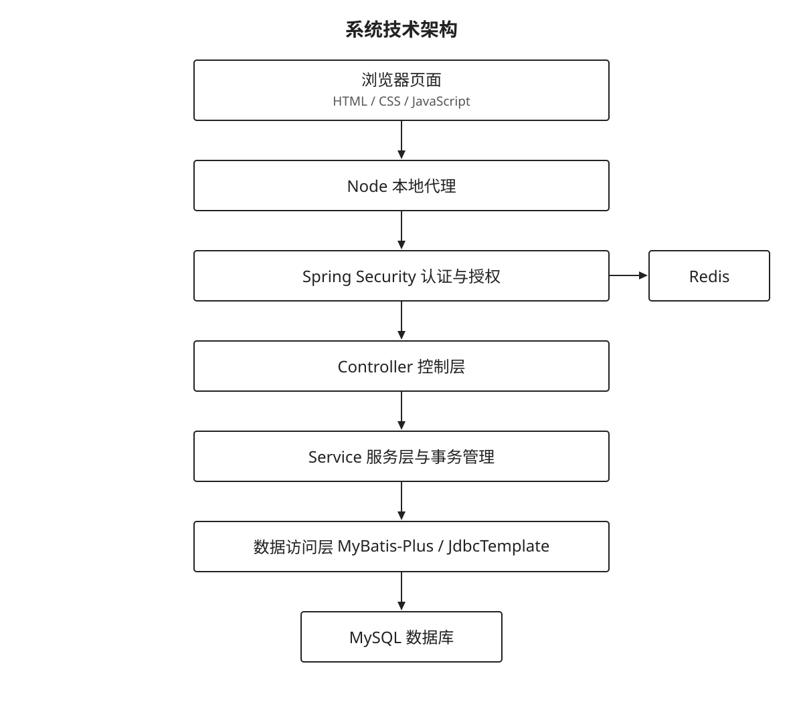

图 3-1 系统技术架构图

### 3.1.1 分层方式与技术选择

本系统采用浏览器访问的 Web 应用形式。浏览器负责展示影片、座位和订单等信息，并将用户操作转换为 HTTP 请求；服务端负责身份确认、业务判断和数据持久化。这样划分后，同一项业务的最终规则集中在服务端，用户更换浏览器或页面布局时不需要重新定义订单和票券状态。前端传入的座位编号、请求参数和身份相关信息均需经过服务端处理，页面只负责展示与交互。

后端以 Spring Boot 组织应用启动和配置，以 Spring MVC 接收 Web 请求，以 Spring Security 配置认证和授权，以 MyBatis-Plus 处理部分实体映射、基础数据访问和分页。上述组件通过 Maven 依赖管理集成，具体版本见表 2-2。订单业务需要在同一事务中处理用户、场次、座位、订单和请求快照，项目在该流程中使用 `JdbcTemplate` 实现跨表操作；影片等模块则通过 MyBatis-Plus Mapper 和 XML 查询访问数据。两种方式均位于数据访问职责范围内，不能将技术名称与层次职责混为一谈。

数据库使用 MySQL 保存需要持续保留的用户、订单和票券等业务数据。Redis 保存令牌对应的登录态，能够根据令牌查找会话并支持撤销；订单和支付的最终业务事实仍以 MySQL 为准。这样分工的直接原因是登录态查询与业务交易数据具有不同的访问方式，但本报告的设计和测试不据此推断系统具备高并发生产能力。

### 3.2 功能模块
系统的用户认证模块为受保护业务提供身份基础；影片和场次模块提供可展示的放映信息；订单模块连接用户、场次和座位；支付与票券模块处理购买结果；退款模块处理符合条件的整单退票；管理模块维护基础数据。后端还提供检票接口，但当前课程演示前端未提供独立的检票页面。管理员创建场次时，系统将物理座位映射为该场次的销售座位；一张订单对应一个场次和一至多个座位，支付成功后生成票券。

课程演示页面的主要功能结构如图 3-2 所示。

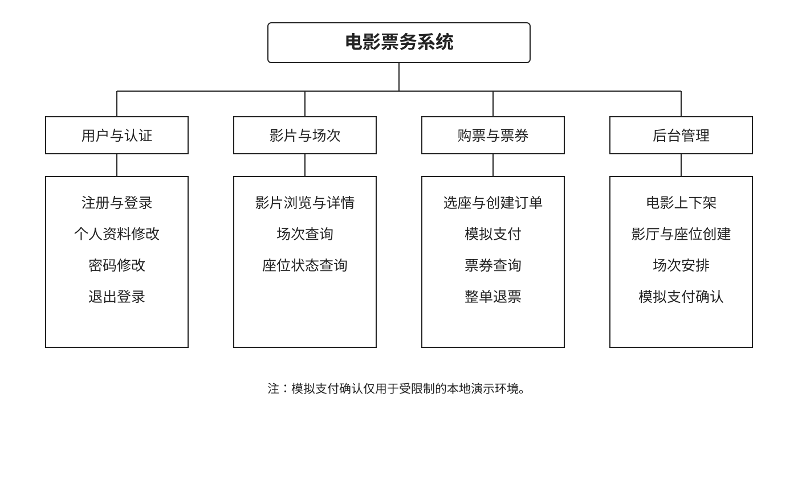

图 3-2 系统功能结构图

### 3.2.1 用户角色与业务边界

系统面向的使用者具有不同的访问范围。游客的主要需求是在购票前查看公开影片、场次和座位状态；这类查询不要求建立登录态。注册用户除继续浏览公开内容外，还需要对本人资料、订单和票券进行操作。管理员需要维护影片与放映资源，检票人员则通过专门接口核验票券。为避免将页面入口误当成权限依据，系统在服务端根据认证身份与角色限制受保护请求，并在处理订单和票券时进一步检查资源归属。

从业务依赖来看，管理员先创建影片、影厅和物理座位，再安排与影片、影厅相对应的场次；用户购买时依据场次座位而非单独依据物理座位进行选择。订单创建并不直接产生有效票券，只有模拟支付结果确认成功后才能进入出票流程。退票与支付又存在前后依赖：申请退款时系统需要检查订单、支付记录和票券状态，申请受理后的结果需继续查询。各模块围绕同一组业务数据协作，任何一个界面显示的状态都应以服务端处理结果为准。

### 3.3 数据库设计

数据库采用 MySQL，表间主要通过标识字段形成逻辑关联，未建立物理外键。用户与角色通过用户角色表关联；电影、影厅和场次描述排片信息；订单、订单明细、场次座位、支付、票券与退款共同记录交易过程。关系图仅展示核心实体，支付、退款及核销等补充关系在下文说明。数据库逻辑关系如图 3-3 所示。

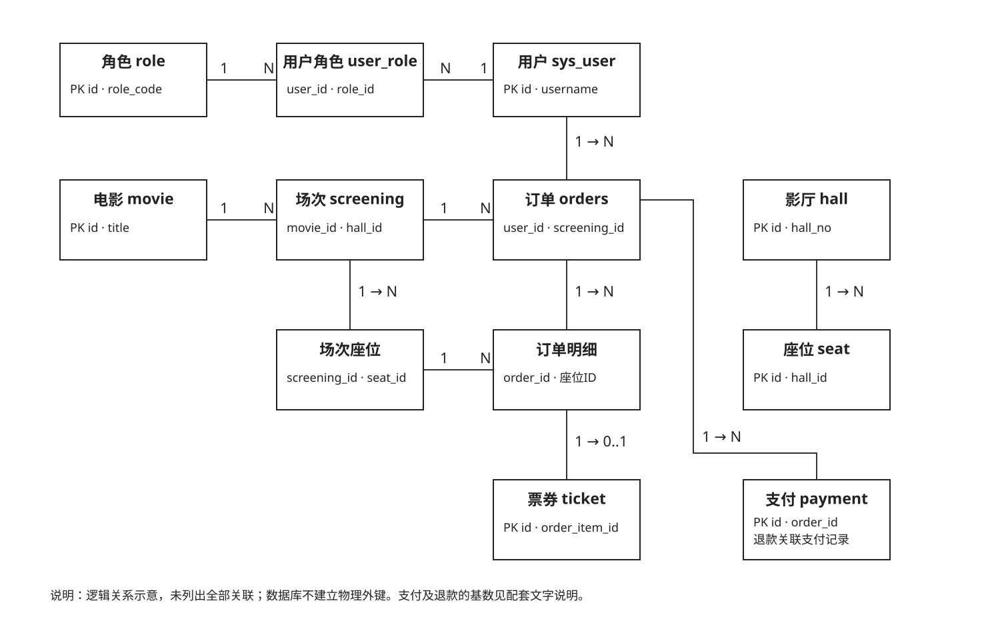

图 3-3 数据库核心实体关系图

一个用户可以创建多个订单，一个场次可以有多个订单；业务创建流程要求每张订单包含一条或多条明细。每条明细最多对应一张票券。一个订单可以有多条支付记录，一条支付记录最多对应一条退款记录。一次成功核销对应一条票券，`ticket_verification.ticket_id` 存在唯一约束。影厅与场次、物理座位与场次座位、支付与退款等关联为避免图线交叉未全部画出，但通过各表关联字段在正文中说明。图中省略的审计、通知、幂等及退款尝试表用于记录交易处理过程。

以下结构依据本次演示库 `information_schema` 导出，并结合数据库迁移脚本说明字段用途。表中“主键”以数据库实际主键为准；带有“逻辑关联”含义的字段不代表已创建物理外键。本次数据库中的业务表主键未设置自增；幂等表没有声明主键，使用复合唯一约束；Flyway 历史表由迁移工具维护。MyBatis-Plus 提供实体与表映射相关注解[9]，数据库事务用于组织需要保持一致性的多步操作[10]。

#### 3.3.1 sys_user 表

系统用户表保存登录凭据、昵称、联系方式和用户状态。该表主键为 `id`，不设置自增。其字段结构如表 3-1 所示。

表 3-1 sys_user 表结构

| 字段名 | 数据类型 | 可为空 | 主键 | 字段说明 |
|---|---|---|---|---|
| `id` | `bigint` | 否 | 是 | 用户主键，由应用生成 |
| `username` | `varchar(64)` | 否 | 否 | 登录用户名 |
| `password` | `varchar(255)` | 否 | 否 | 密码密文，不保存明文 |
| `nickname` | `varchar(64)` | 是 | 否 | 用户昵称 |
| `avatar` | `varchar(255)` | 是 | 否 | 头像地址 |
| `email` | `varchar(128)` | 是 | 否 | 电子邮箱 |
| `phone` | `varchar(32)` | 是 | 否 | 手机号码 |
| `status` | `tinyint` | 否 | 否 | 用户状态：0 正常，1 禁用 |
| `create_time` | `datetime` | 否 | 否 | 创建时间 |
| `update_time` | `datetime` | 否 | 否 | 最后更新时间 |
| `auth_version` | `bigint` | 否 | 否 | 登录态版本 |

#### 3.3.2 role 表

角色表保存管理员、检票人员和普通用户等角色信息。该表主键为 `id`，不设置自增。其字段结构如表 3-2 所示。

表 3-2 role 表结构

| 字段名 | 数据类型 | 可为空 | 主键 | 字段说明 |
|---|---|---|---|---|
| `id` | `bigint` | 否 | 是 | 角色主键，初始角色使用固定标识 |
| `role_code` | `varchar(50)` | 否 | 否 | 角色编码，例如 ADMIN、CHECKIN_STAFF |
| `role_name` | `varchar(50)` | 否 | 否 | 角色名称 |
| `role_desc` | `varchar(255)` | 是 | 否 | 角色描述 |
| `create_time` | `datetime` | 否 | 否 | 创建时间 |
| `update_time` | `datetime` | 否 | 否 | 最后更新时间 |

#### 3.3.3 user_role 表

用户角色表保存用户与角色的对应关系。该表主键为 `id`，不设置自增。其字段结构如表 3-3 所示。

表 3-3 user_role 表结构

| 字段名 | 数据类型 | 可为空 | 主键 | 字段说明 |
|---|---|---|---|---|
| `id` | `bigint` | 否 | 是 | 用户角色关系主键 |
| `user_id` | `bigint` | 否 | 否 | 用户 ID，逻辑关联 sys_user.id |
| `role_id` | `bigint` | 否 | 否 | 角色 ID，逻辑关联 role.id |
| `create_time` | `datetime` | 否 | 否 | 创建时间 |
| `update_time` | `datetime` | 否 | 否 | 最后更新时间 |

#### 3.3.4 movie 表

电影表保存名称、简介、上映日期、片长和发行状态。该表主键为 `id`，不设置自增。其字段结构如表 3-4 所示。

表 3-4 movie 表结构

| 字段名 | 数据类型 | 可为空 | 主键 | 字段说明 |
|---|---|---|---|---|
| `id` | `bigint` | 否 | 是 | 电影主键 |
| `title` | `varchar(255)` | 否 | 否 | 电影名称 |
| `description` | `text` | 是 | 否 | 电影简介 |
| `release_date` | `date` | 否 | 否 | 上映日期 |
| `duration_minutes` | `int` | 否 | 否 | 影片播放时长（分钟） |
| `publish_at` | `datetime` | 是 | 否 | 系统自动发行时间，按 UTC 存储 |
| `status` | `tinyint` | 否 | 否 | 电影状态：0 上架，1 下架 |
| `version` | `int` | 否 | 否 | 乐观锁版本 |
| `create_time` | `datetime` | 否 | 否 | 创建时间 |
| `update_time` | `datetime` | 否 | 否 | 最后更新时间 |

#### 3.3.5 hall 表

影厅表保存影厅编号、名称、状态及版本信息。该表主键为 `id`，不设置自增。其字段结构如表 3-5 所示。

表 3-5 hall 表结构

| 字段名 | 数据类型 | 可为空 | 主键 | 字段说明 |
|---|---|---|---|---|
| `id` | `bigint` | 否 | 是 | 影厅主键 |
| `hall_name` | `varchar(64)` | 否 | 否 | 影厅名称 |
| `hall_no` | `varchar(32)` | 否 | 否 | 影厅编号 |
| `status` | `tinyint` | 否 | 否 | 影厅状态：0 启用，1 停用 |
| `schedule_version` | `bigint` | 否 | 否 | 同影厅排片乐观锁版本 |
| `create_time` | `datetime` | 否 | 否 | 创建时间 |
| `update_time` | `datetime` | 否 | 否 | 最后更新时间 |
| `version` | `int` | 否 | 否 | 影厅维护编辑版本 |

#### 3.3.6 seat 表

物理座位表保存影厅中的排号、座号和启用状态。该表主键为 `id`，不设置自增。其字段结构如表 3-6 所示。

表 3-6 seat 表结构

| 字段名 | 数据类型 | 可为空 | 主键 | 字段说明 |
|---|---|---|---|---|
| `id` | `bigint` | 否 | 是 | 物理座位主键 |
| `hall_id` | `bigint` | 否 | 否 | 影厅 ID，逻辑关联 hall.id |
| `row_number` | `int` | 否 | 否 | 座位排号，从 1 开始 |
| `seat_number` | `int` | 否 | 否 | 排内座位号，从 1 开始 |
| `status` | `tinyint` | 否 | 否 | 座位状态：0 启用，1 停用 |
| `create_time` | `datetime` | 否 | 否 | 创建时间 |
| `update_time` | `datetime` | 否 | 否 | 最后更新时间 |
| `version` | `int` | 否 | 否 | 物理座位维护编辑版本 |

#### 3.3.7 screening 表

放映场次表保存电影、影厅、时间、价格和售票状态。该表主键为 `id`，不设置自增。其字段结构如表 3-7 所示。

表 3-7 screening 表结构

| 字段名 | 数据类型 | 可为空 | 主键 | 字段说明 |
|---|---|---|---|---|
| `id` | `bigint` | 否 | 是 | 场次主键 |
| `price` | `decimal(10,2)` | 否 | 否 | 场次单张票价 |
| `movie_id` | `bigint` | 否 | 否 | 电影 ID，逻辑关联 movie.id |
| `hall_id` | `bigint` | 否 | 否 | 影厅 ID，逻辑关联 hall.id |
| `start_time` | `datetime` | 否 | 否 | 放映开始时间 |
| `end_time` | `datetime` | 否 | 否 | 放映结束时间 |
| `duration_minutes_snapshot` | `int` | 否 | 否 | 排片时片长快照（分钟） |
| `turnaround_minutes_snapshot` | `int` | 否 | 否 | 场间周转时间快照（分钟） |
| `sale_start_time` | `datetime` | 否 | 否 | 开始售票时间 |
| `sale_end_time` | `datetime` | 否 | 否 | 停止售票时间 |
| `admission_open_time` | `datetime` | 否 | 否 | 允许入场时间，影院 Asia/Shanghai 业务时间 |
| `status` | `tinyint` | 否 | 否 | 场次状态：0 待开售，1 开售，2 停售，3 关闭，4 已结束 |
| `version` | `int` | 否 | 否 | 版本号 |
| `create_time` | `datetime` | 否 | 否 | 创建时间 |
| `update_time` | `datetime` | 否 | 否 | 最后更新时间 |

#### 3.3.8 screening_seat 表

场次座位表记录某场次每个座位的销售状态及关联订单。该表主键为 `id`，不设置自增。其字段结构如表 3-8 所示。

表 3-8 screening_seat 表结构

| 字段名 | 数据类型 | 可为空 | 主键 | 字段说明 |
|---|---|---|---|---|
| `id` | `bigint` | 否 | 是 | 场次座位主键 |
| `seat_id` | `bigint` | 否 | 否 | 物理座位 ID，逻辑关联 seat.id |
| `screening_id` | `bigint` | 否 | 否 | 场次 ID，逻辑关联 screening.id |
| `status` | `tinyint` | 否 | 否 | 场次座位状态：0 可售，1 占用，2 已售，3 禁售 |
| `order_id` | `bigint` | 是 | 否 | 占用或售出该座位的订单 ID，逻辑关联 orders.id |
| `create_time` | `datetime` | 否 | 否 | 创建时间 |
| `update_time` | `datetime` | 否 | 否 | 最后更新时间 |

#### 3.3.9 orders 表

订单表保存下单用户、场次、金额、期限及订单状态。该表主键为 `id`，不设置自增。其字段结构如表 3-9 所示。

表 3-9 orders 表结构

| 字段名 | 数据类型 | 可为空 | 主键 | 字段说明 |
|---|---|---|---|---|
| `id` | `bigint` | 否 | 是 | 订单主键 |
| `order_no` | `varchar(32)` | 否 | 否 | 订单业务编号 |
| `user_id` | `bigint` | 否 | 否 | 下单用户 ID，逻辑关联 sys_user.id |
| `screening_id` | `bigint` | 否 | 否 | 场次 ID，逻辑关联 screening.id |
| `total_amount` | `decimal(10,2)` | 否 | 否 | 订单总金额 |
| `expires_at` | `datetime` | 否 | 否 | 实际支付截止（UTC）：下单后15分钟与场次售票截止取早；不回写历史订单 |
| `status` | `tinyint` | 否 | 否 | 订单状态：0 待支付，1 已支付，2 已取消，3 已过期，4 退款中，5 已退款 |
| `version` | `int` | 否 | 否 | 订单乐观锁版本 |
| `create_time` | `datetime` | 否 | 否 | 创建时间 |
| `update_time` | `datetime` | 否 | 否 | 最后更新时间 |

#### 3.3.10 order_item 表

订单明细表记录订单所选场次座位和购票单价。该表主键为 `id`，不设置自增。其字段结构如表 3-10 所示。

表 3-10 order_item 表结构

| 字段名 | 数据类型 | 可为空 | 主键 | 字段说明 |
|---|---|---|---|---|
| `id` | `bigint` | 否 | 是 | 订单明细主键 |
| `order_id` | `bigint` | 否 | 否 | 订单 ID，逻辑关联 orders.id |
| `screening_seat_id` | `bigint` | 否 | 否 | 场次座位 ID，逻辑关联 screening_seat.id |
| `unit_price` | `decimal(10,2)` | 否 | 否 | 购票时的单价快照 |
| `create_time` | `datetime` | 否 | 否 | 创建时间 |
| `update_time` | `datetime` | 否 | 否 | 最后更新时间 |

#### 3.3.11 payment 表

支付表保存模拟支付记录、金额、状态及渠道尝试标识。该表主键为 `id`，不设置自增。其字段结构如表 3-11 所示。

表 3-11 payment 表结构

| 字段名 | 数据类型 | 可为空 | 主键 | 字段说明 |
|---|---|---|---|---|
| `id` | `bigint` | 否 | 是 | 支付记录主键 |
| `payment_no` | `varchar(64)` | 否 | 否 | 支付业务编号 |
| `order_id` | `bigint` | 否 | 否 | 订单 ID，逻辑关联 orders.id |
| `amount` | `decimal(10,2)` | 否 | 否 | 支付金额 |
| `currency` | `char(3)` | 否 | 否 | 支付币种 |
| `status` | `tinyint` | 否 | 否 | 支付状态：0 待支付，1 支付成功，2 支付失败 |
| `version` | `int` | 否 | 否 | 支付乐观锁版本 |
| `attempt_id` | `varchar(64)` | 否 | 否 | 当前支付渠道尝试标识 |
| `successful_order_id` | `bigint` | 是 | 否 | 生成列，仅成功支付时保存订单标识，用于唯一约束 |
| `create_time` | `datetime` | 否 | 否 | 创建时间 |
| `update_time` | `datetime` | 否 | 否 | 最后更新时间 |

#### 3.3.12 payment_notification 表

支付通知表保存渠道事件与去重所需信息。该表主键为 `id`，不设置自增。其字段结构如表 3-12 所示。

表 3-12 payment_notification 表结构

| 字段名 | 数据类型 | 可为空 | 主键 | 字段说明 |
|---|---|---|---|---|
| `id` | `bigint` | 否 | 是 | 记录标识 |
| `provider` | `varchar(32)` | 否 | 否 | 通知渠道标识 |
| `event_id` | `varchar(128)` | 否 | 否 | 渠道事件标识 |
| `payment_no` | `varchar(64)` | 否 | 否 | 支付业务编号 |
| `event_type` | `varchar(32)` | 否 | 否 | 事件类型 |
| `payload_hash` | `binary(32)` | 否 | 否 | 事件内容摘要 |
| `processed_at` | `datetime` | 否 | 否 | 处理时间 |
| `create_time` | `datetime` | 否 | 否 | 创建时间 |
| `attempt_id` | `varchar(64)` | 否 | 否 | 渠道通知对应的支付尝试 |

#### 3.3.13 payment_audit 表

支付审计表记录支付操作、状态变化和来源。该表主键为 `id`，不设置自增。其字段结构如表 3-13 所示。

表 3-13 payment_audit 表结构

| 字段名 | 数据类型 | 可为空 | 主键 | 字段说明 |
|---|---|---|---|---|
| `id` | `bigint` | 否 | 是 | 记录标识 |
| `payment_id` | `bigint` | 否 | 否 | 关联支付记录标识 |
| `order_id` | `bigint` | 否 | 否 | 关联订单标识 |
| `operator_id` | `bigint` | 是 | 否 | 操作人标识 |
| `operation` | `varchar(64)` | 否 | 否 | 业务操作类型 |
| `from_status` | `tinyint` | 是 | 否 | 变更前状态 |
| `to_status` | `tinyint` | 是 | 否 | 变更后状态 |
| `source` | `varchar(32)` | 否 | 否 | 操作或退款来源 |
| `request_id` | `varchar(64)` | 是 | 否 | 请求追踪标识 |
| `event_id` | `varchar(128)` | 是 | 否 | 渠道事件标识 |
| `remark` | `varchar(255)` | 是 | 否 | 审计备注 |
| `create_time` | `datetime` | 否 | 否 | 创建时间 |

#### 3.3.14 ticket 表

票券表记录订单明细对应的票码和票券状态。该表主键为 `id`，不设置自增。其字段结构如表 3-14 所示。

表 3-14 ticket 表结构

| 字段名 | 数据类型 | 可为空 | 主键 | 字段说明 |
|---|---|---|---|---|
| `id` | `bigint` | 否 | 是 | 票券主键 |
| `status` | `tinyint` | 否 | 否 | 票券状态：0 有效，1 已核销，2 已作废 |
| `order_item_id` | `bigint` | 否 | 否 | 订单明细 ID，逻辑关联 order_item.id |
| `ticket_code` | `varchar(128)` | 否 | 否 | 票券码，供用户扫码入场 |
| `create_time` | `datetime` | 否 | 否 | 创建时间 |
| `update_time` | `datetime` | 否 | 否 | 最后更新时间 |

#### 3.3.15 ticket_verification 表

票券核销表记录成功核销的票券、操作人员及时间。该表主键为 `id`，不设置自增。其字段结构如表 3-15 所示。

表 3-15 ticket_verification 表结构

| 字段名 | 数据类型 | 可为空 | 主键 | 字段说明 |
|---|---|---|---|---|
| `id` | `bigint` | 否 | 是 | 核销记录主键 |
| `ticket_id` | `bigint` | 否 | 否 | 票券 ID，逻辑关联 ticket.id |
| `operator_id` | `bigint` | 否 | 否 | 核销人员 ID，逻辑关联 sys_user.id |
| `device_code` | `varchar(64)` | 否 | 否 | 扫码设备编号，不关联独立设备表 |
| `verified_at` | `datetime` | 否 | 否 | 实际核销时间 |
| `create_time` | `datetime` | 否 | 否 | 核销记录创建时间 |

#### 3.3.16 refund 表

退款表保存关联订单、支付、退款金额及处理状态。该表主键为 `id`，不设置自增。其字段结构如表 3-16 所示。

表 3-16 refund 表结构

| 字段名 | 数据类型 | 可为空 | 主键 | 字段说明 |
|---|---|---|---|---|
| `id` | `bigint` | 否 | 是 | 退款记录主键 |
| `refund_no` | `varchar(64)` | 否 | 否 | 退款业务编号 |
| `order_id` | `bigint` | 否 | 否 | 订单 ID，逻辑关联 orders.id |
| `payment_id` | `bigint` | 否 | 否 | 支付记录 ID，逻辑关联 payment.id |
| `amount` | `decimal(10,2)` | 否 | 否 | 退款金额 |
| `status` | `tinyint` | 否 | 否 | 退款状态：0 待处理，1 退款成功，2 退款失败 |
| `create_time` | `datetime` | 否 | 否 | 创建时间 |
| `update_time` | `datetime` | 否 | 否 | 最后更新时间 |
| `source` | `varchar(24)` | 否 | 否 | 操作或退款来源 |
| `attempt_no` | `int` | 否 | 否 | 处理尝试序号 |
| `next_run_at` | `datetime(6)` | 是 | 否 | 下次计划处理时间 |
| `lease_token` | `varchar(64)` | 是 | 否 | 处理租约标识 |
| `lease_until` | `datetime(6)` | 是 | 否 | 处理租约截止时间 |

#### 3.3.17 refund_attempt 表

退款尝试表记录每次退款处理尝试的状态。该表主键为 `refund_id`、`attempt_no`，不设置自增。其字段结构如表 3-17 所示。

表 3-17 refund_attempt 表结构

| 字段名 | 数据类型 | 可为空 | 主键 | 字段说明 |
|---|---|---|---|---|
| `refund_id` | `bigint` | 否 | 是 | 关联退款记录标识 |
| `attempt_no` | `int` | 否 | 是 | 处理尝试序号 |
| `status` | `varchar(16)` | 否 | 否 | 业务状态 |
| `submitted` | `tinyint(1)` | 否 | 否 | 是否已提交渠道处理 |
| `create_time` | `datetime(6)` | 否 | 否 | 创建时间 |
| `update_time` | `datetime(6)` | 否 | 否 | 更新时间 |

#### 3.3.18 refund_audit 表

退款审计表记录退款处理操作及操作人员。该表主键为 `id`，不设置自增。其字段结构如表 3-18 所示。

表 3-18 refund_audit 表结构

| 字段名 | 数据类型 | 可为空 | 主键 | 字段说明 |
|---|---|---|---|---|
| `id` | `bigint` | 否 | 是 | 记录标识 |
| `refund_id` | `bigint` | 否 | 否 | 关联退款记录标识 |
| `operation` | `varchar(64)` | 否 | 否 | 业务操作类型 |
| `operator_id` | `bigint` | 是 | 否 | 操作人标识 |
| `create_time` | `datetime(6)` | 否 | 否 | 创建时间 |

#### 3.3.19 refund_simulated_result 表

模拟退款结果表保存模拟渠道的退款结果。该表主键为 `refund_no`、`attempt_no`，不设置自增。其字段结构如表 3-19 所示。

表 3-19 refund_simulated_result 表结构

| 字段名 | 数据类型 | 可为空 | 主键 | 字段说明 |
|---|---|---|---|---|
| `refund_no` | `varchar(64)` | 否 | 是 | 退款业务编号 |
| `attempt_no` | `int` | 否 | 是 | 处理尝试序号 |
| `payment_no` | `varchar(64)` | 否 | 否 | 支付业务编号 |
| `amount` | `decimal(10,2)` | 否 | 否 | 退款金额 |
| `result` | `varchar(16)` | 否 | 否 | 模拟处理结果 |
| `create_time` | `datetime(6)` | 否 | 否 | 创建时间 |
| `successful_refund_no` | `varchar(64)` | 是 | 否 | 成功退款编号生成列，用于唯一约束 |

#### 3.3.20 api_idempotency 表

接口幂等表保存操作键、请求摘要及响应快照。该表没有声明主键，`operator_id`、`operation` 和 `idempotency_key` 组成复合唯一约束，不设置自增。其字段结构如表 3-20 所示。

表 3-20 api_idempotency 表结构

| 字段名 | 数据类型 | 可为空 | 主键 | 字段说明 |
|---|---|---|---|---|
| `operator_id` | `bigint` | 否 | 否 | 操作用户标识，参与复合唯一约束 |
| `operation` | `varchar(64)` | 否 | 否 | 业务操作类型，参与复合唯一约束 |
| `idempotency_key` | `varchar(128)` | 否 | 否 | 客户端请求键，参与复合唯一约束 |
| `request_digest` | `char(64)` | 否 | 否 | 请求内容摘要 |
| `response_json` | `json` | 是 | 否 | 成功响应快照 |
| `expires_at` | `datetime(6)` | 否 | 否 | 记录过期时间 |

#### 3.3.21 flyway_schema_history 表

Flyway 历史表由迁移工具维护，记录迁移版本和校验信息。该表主键为 `installed_rank`，不设置自增。其字段结构如表 3-21 所示。

表 3-21 flyway_schema_history 表结构

| 字段名 | 数据类型 | 可为空 | 主键 | 字段说明 |
|---|---|---|---|---|
| `installed_rank` | `int` | 否 | 是 | 迁移安装顺序 |
| `version` | `varchar(50)` | 是 | 否 | 版本号 |
| `description` | `varchar(200)` | 否 | 否 | 迁移说明 |
| `type` | `varchar(20)` | 否 | 否 | 迁移类型 |
| `script` | `varchar(1000)` | 否 | 否 | 迁移脚本名称 |
| `checksum` | `int` | 是 | 否 | 脚本校验值 |
| `installed_by` | `varchar(100)` | 否 | 否 | 执行迁移的数据库用户 |
| `installed_on` | `timestamp` | 否 | 否 | 执行时间 |
| `execution_time` | `int` | 否 | 否 | 执行耗时（毫秒） |
| `success` | `tinyint(1)` | 否 | 否 | 迁移是否成功 |

数据库表之间的主要业务关系还需要结合唯一约束理解。`user_role` 以用户和角色标识建立关联，使一个用户可以具有一个或多个角色。`screening` 中的电影和影厅标识分别指向场次所对应的影片与放映厅；`screening_seat` 将某个场次和物理座位组合，并保存该场次的销售状态。订单明细使用 `screening_seat_id` 表示购买对象，使订单不仅记录座位位置，也记录该座位属于哪一场放映。

支付表使用支付业务编号区分记录，生成列 `successful_order_id` 配合唯一约束限制同一订单成功支付记录；这一约束与服务层状态校验共同发挥作用。票券表对 `order_item_id` 设置唯一约束，因此一个订单明细最多对应一张票券。退款表对 `payment_id` 设置唯一约束，退款尝试和审计表则保存处理过程。接口幂等表通过操作人、操作类型和请求键的组合区分成功请求快照；它没有声明主键，不能将复合唯一索引误写为主键。

本系统没有在这些表之间建立物理外键，关联字段的业务有效性由应用处理，必要的唯一性和取值范围由数据库约束辅助保证。采用逻辑关联并不意味着可以忽略数据完整性：查询与写入时仍需检查相关记录存在、所属关系正确，并在事务中协调状态更新。

### 3.4 项目结构

项目文件按前端页面、后端 Java 代码、资源配置、测试与文档进行组织。前端 `app.js` 负责路由和页面请求；`server.js` 提供本机静态文件及代理。后端控制器按用户与管理入口分包，模型分为实体、请求对象和响应对象。数据库迁移文件位于 `resources/db/migration`，应用启动时由 Flyway 根据已记录的版本执行迁移。

项目文件组织如图 3-4 所示。

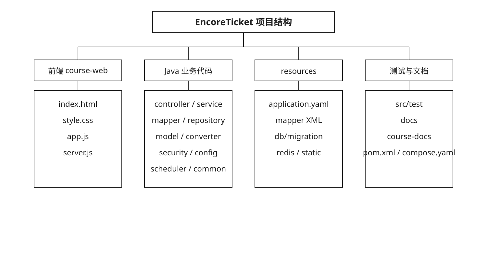

图 3-4 项目结构图

controller 存放用户与管理员接口；service 执行业务规则；mapper 和 resources/mapper 提供数据库访问；repository 封装少量复杂持久化流程；model 保存实体、请求和响应模型；security 负责认证授权；scheduler 负责超时等状态推进；config 提供配置与 Bean；course-web 保存本次增加的页面及本机代理。

主要目录、代表文件及作用如表 3-22 所示。

表 3-22 项目主要包与代表文件

| 包或目录 | 代表文件 | 主要作用 |
|---|---|---|
| controller/user | UserOrderWorkflowController | 接收本人订单请求并调用服务层 |
| service/impl | OrderServiceImpl | 组织订单业务规则与调用 |
| mapper | MovieMapper | 声明电影数据访问方法 |
| resources/mapper | OrderMapper.xml 等 | 保存自定义 SQL 映射 |
| security | SecurityConfig、RedisTokenAuthenticationFilter | 配置认证授权并解析令牌 |
| config | MybatisPlusConfig | 注册分页及乐观锁插件 Bean |
| scheduler | OrderExpirationScheduler | 推进到期订单处理 |
| course-web | index.html、app.js、style.css、server.js | 页面结构、交互、样式及本地代理 |

除了后端代码，视图页面也是系统项目结构的一部分。首页与影片详情页面负责向游客呈现影片和场次信息；选座页面显示场次座位状态并汇总已选座位；订单和票券页面用于查询本人业务记录；个人中心提供资料和密码修改入口；管理中心组织影片、影厅、场次及模拟支付确认操作。`app.js` 根据当前页面发起接口请求和更新视图，页面展示的状态由后端响应决定；`style.css` 负责页面排版，`server.js` 在本机提供静态资源并代理接口请求。

## 4 详细设计与实现
### 4.1 用户注册与登录
注册时系统校验用户名、密码、确认密码及昵称，保存密码编码，并在服务端建立账号与默认角色。登录成功后返回不透明访问令牌，客户端通过请求头携带 Bearer 令牌。认证过滤器读取 Redis 登录态并检查数据库用户状态及版本；Redis 提供键值数据操作能力[11]，Spring Security 提供认证与授权支持[12]。受保护接口根据服务端认证结果识别用户；修改密码成功后旧登录态失效。

登录流程如图 4-1 所示。账号或密码不匹配时提示用户重新输入；账号状态异常或依赖故障时按相应错误处理。只有验证通过且登录态建立成功后，客户端才能使用令牌访问授权功能。

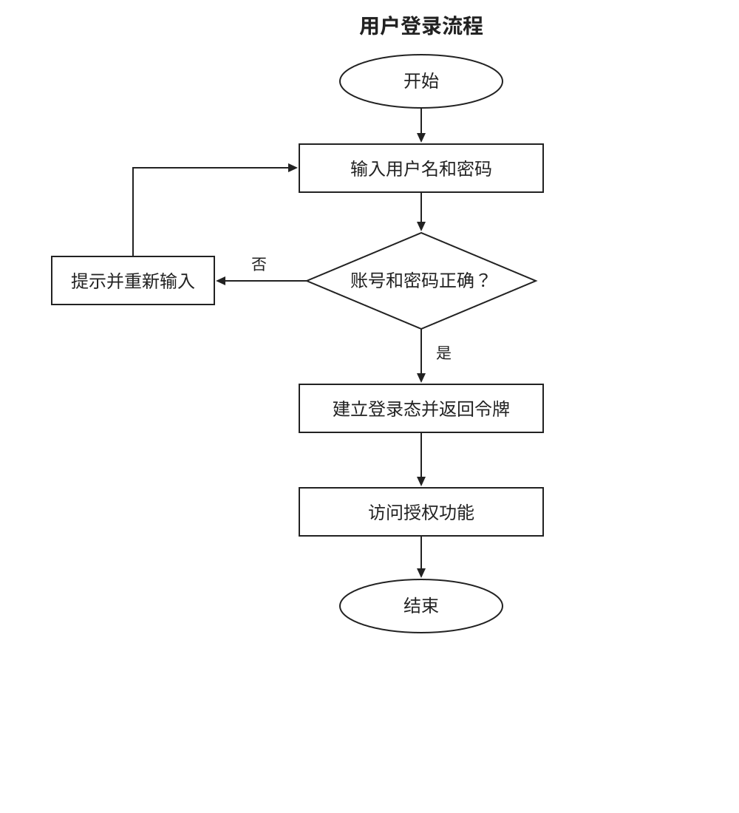

图 4-1 用户登录流程图

用户登录页面如图 4-2 所示。

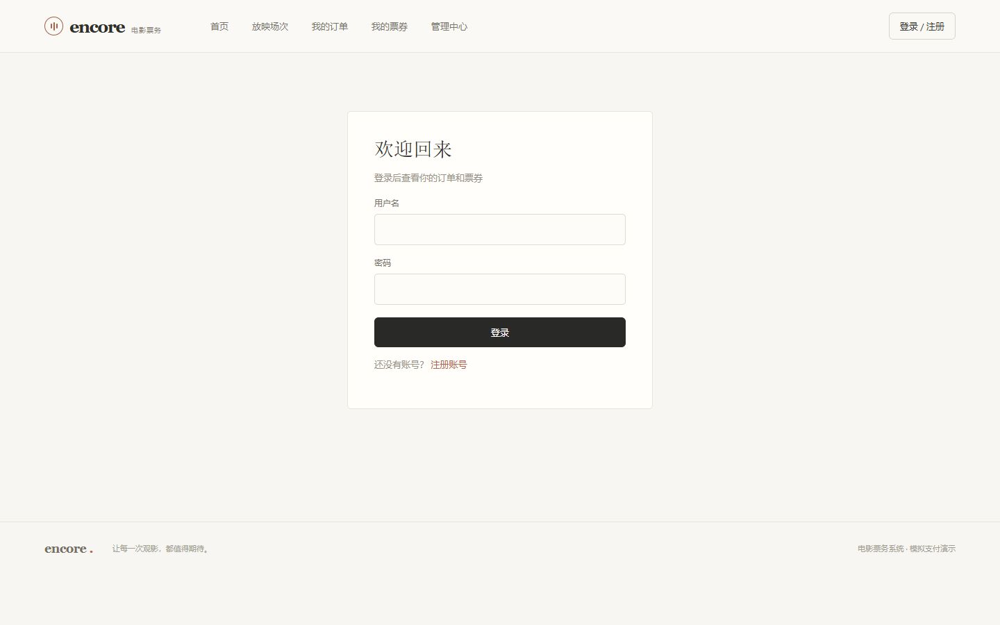

图 4-2 用户登录页面

#### 4.1.1 注册、登录与身份识别过程

注册页面收集用户名、密码、确认密码和昵称。`UserAccountController` 使用 `@RequestBody` 接收注册信息，并通过 `@Valid` 触发请求对象上的校验规则。校验通过后，控制器调用 `UserService` 完成注册，服务端对密码进行编码后保存，并建立默认用户角色。注册成功响应包含登录态信息，页面据此更新当前用户状态。客户端收到的用户资料不包含密码，输入的明文密码也不作为普通业务字段写入数据库。

登录页面提交用户名和密码后，`UserAuthController` 将请求绑定为 `LoginRequest` 并交由 `AuthService` 处理。用户名按项目规则规范化，密码保持用户输入原样。服务端校验凭据和账号状态，通过后生成不透明访问令牌，并将对应会话信息保存到 Redis。浏览器访问订单等受保护资源时，将令牌放入 `Authorization: Bearer` 请求头；过滤器读取令牌、查询登录态并核对数据库中的用户状态与登录态版本，再将认证结果交给后续授权流程。

认证通过并不表示用户可以访问任意订单。订单详情、支付和票券查询还需要根据认证用户检查资源归属；对于不存在或不属于当前用户的资源，系统按接口约定处理。资料修改与密码修改分别通过不同入口完成：资料接口仅允许修改约定字段；密码修改校验旧密码并在成功后使旧登录态失效。如此将登录、角色权限和具体数据范围分开处理，有助于明确每一层的安全职责。

### 4.2 电影、影厅与场次
影片与场次分别维护，影片表示可供展示和排片的作品，场次表示某一影片在某一影厅和时间的具体放映。影厅包含物理座位，而场次座位描述该物理座位在特定场次中的销售状态。区分这两类座位，可以避免将某一场次的占用状态误认为物理座位本身的永久状态。

管理员创建影片、影厅和场次后，普通用户通过公开接口查询符合展示条件的数据。前端将影片、放映厅、时间和票价组织为可浏览页面；选座页面取得的场次座位标识会在创建订单时提交，服务端仍需重新检查该标识与场次的对应关系及当前状态。

电影首页与影片详情分别如图 4-3 和图 4-4 所示。影片名称、简介、片长和场次来自本地演示数据，示例资料不作为现实影片信息的事实来源。


图 4-3 系统首页


图 4-4 影片详情页面

#### 4.2.1 影片查询的数据访问过程

影片实体 `Movie` 通过 `@TableName("movie")` 指定对应数据库表，主键字段使用 MyBatis-Plus 的标识配置；实体中的片名、简介、上映日期和状态等属性与表字段对应。`MovieMapper` 继承 `BaseMapper<Movie>`，并声明 `selectMoviePage` 等查询方法。服务层根据请求中的查询条件、分页参数和允许的排序字段组织查询，再调用 Mapper；自定义查询在 `MovieMapper.xml` 中根据传入条件拼接相应查询片段。

影片列表中的分页并不由浏览器自行截取全部记录完成。项目配置 `PaginationInnerInterceptor`，并在影片服务中使用分页对象调用 Mapper，使查询结果按指定页码和页大小返回。对影片名称前缀查询，SQL 对部分通配符进行转义，避免把用户输入简单当作查询通配模式。项目通过受限的排序字段选择生成排序条件，避免将任意客户端文本直接作为排序列名。

管理员创建的放映场次关联电影和影厅，场次包含开始与结束时间、售票时间和价格。前端展示的时间来自接口响应；选择座位时查询场次座位列表，用户看到的可售结果只是查询时刻的状态。由于此后其他请求仍可能改变座位，创建订单时服务端需要在事务内再次核验场次、座位和物理座位的状态。

### 4.3 订单和模拟支付
Spring 的事务管理支持声明式事务[13]，本项目订单创建流程使用编程式事务组织相关操作。

订单创建时，服务端先检查提交的座位数量、重复座位和标识格式，再根据用户、操作类型和幂等键检查已有成功请求快照。同一个有效键对应的请求摘要不一致时返回冲突；满足重放条件时返回已有结果。对于新的下单请求，系统检查场次购买资格及座位状态，创建订单、订单明细和座位占用记录，并保存成功响应快照。相关实现使用事务管理器组织数据库操作，不能仅依赖页面上显示的可售状态完成最终判断。

订单创建后，用户可发起支付。项目当前使用模拟渠道，管理员在受限的本地演示环境中提交模拟结果，服务端按既定业务规则处理确认事件。订单处于待支付并不表示已收款，支付请求已受理也不表示结果已确认；只有成功结算后，页面才显示已支付并可查询生成的票券。对于取消、到期或结果未知等情况，系统按照实际状态处理，不能简单把所有非成功状态视为失败。

购票业务处理过程如图 4-5 所示，选座页面如图 4-6 所示。图中“结束”表示当前演示操作暂时结束；支付结果未确认时仍应查询结果，不能将等待状态视为支付成功或资金处理终态。

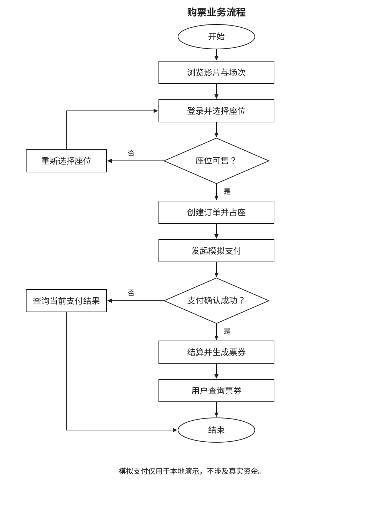

图 4-5 购票业务流程图

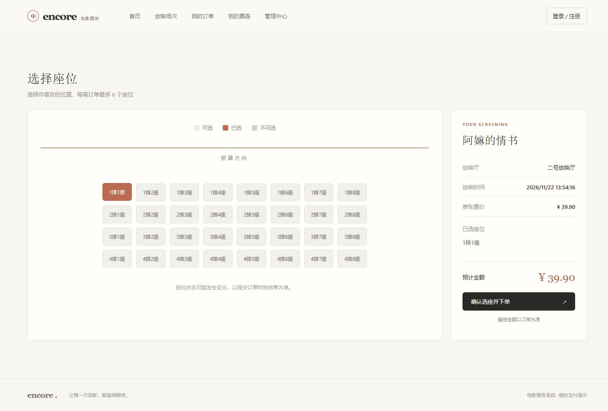

图 4-6 选座页面

订单创建控制器的关键代码如下。它从请求头获取幂等键，从请求体获取下单信息，并把认证用户、请求键与请求体交给服务层处理；代码省略了类声明和辅助方法。

```java
@PostMapping
@ResponseStatus(HttpStatus.CREATED)
public ApiResponse<OrderDetailVO> create(
        @RequestHeader("Idempotency-Key") String key,
        @RequestBody CreateOrderRequest body,
        Authentication authentication, HttpServletRequest request) {
    query(request, Set.of());
    if (Collections.list(request.getHeaders("Idempotency-Key")).size() != 1)
        throw invalid();
    return ApiResponse.of(orders.create(user(authentication), key, body));
}
```

该代码位于 `UserOrderWorkflowController`，控制器负责入口校验和调用 `OrderService`，座位资格、订单创建及持久化由下层业务流程处理。

#### 4.3.1 订单状态和有效期限

订单创建成功后处于待支付状态，系统为订单和对应的场次座位记录建立关联。根据项目规则，实际付款截止取订单创建后 15 分钟、订单记录中的过期时间以及场次售票截止时间中的较早值；达到截止时间即不再满足付款资格。若待支付订单到期，系统将其推进为过期并释放仍由该订单占用的座位。用户主动取消与系统到期是不同的状态变化，两者均不意味着已支付订单可以直接按待支付流程处理。

客户端查询订单时，服务端依据当前时刻计算有效展示状态。待支付订单如果已达到期限，可以在查询响应中显示为已过期；查询本身不负责释放座位或修改数据库。实际状态推进由定时任务或相关业务写操作完成。区分查询展示与持久化处理，有利于避免把只读查询当作完成库存释放的依据。

如果订单已经取消或到期后才收到模拟渠道的成功结果，项目设计要求保留支付事实并进入补偿退款流程，不重新占座或生成新的有效票券。此处属于异常时序下的业务设计；本次浏览器演示只覆盖正常支付和主动退票，没有以一次正常流程证明所有迟到通知与并发竞争均已验证。

#### 4.3.2 幂等与重复请求处理

网络重试可能使同一业务请求重复到达。对于项目中明确要求请求键的订单创建、支付和退款等入口，客户端为一次业务操作提供 `Idempotency-Key`，服务端结合操作人、操作类型和请求内容判断是否属于同一请求。订单创建成功后保存请求摘要和响应快照；相同键与相同内容在约定期限内重放时返回已有成功结果，相同键与不同内容则产生冲突。新的业务操作应使用新的请求键。

请求幂等不能替代业务状态校验。即使客户端使用不同的请求键，服务端仍需检查用户在同一场次是否存在有效待支付订单，并在锁定和重新读取后核验场次座位状态。相应订单、明细、座位占用和成功快照在事务中协调保存；数据库中的唯一约束、条件更新与服务层判断共同参与保护。系统中并非所有写接口都使用相同的请求键契约，电影和场次管理接口应按照各自接口规则处理。

### 4.4 票券与退款
票券与订单明细关联，一条订单明细最多生成一张票券。票券包含票码和状态，用户查询接口以登录身份限制数据范围。退票以订单为单位，系统在申请时检查订单、支付及票券是否满足资格；退款受理后先进入处理状态，后台模拟处理完成后更新订单和票券状态。若票券已核销或达到相应截止条件，则不能将其视为普通可退订单处理。

模拟支付完成后的订单与票券页面分别如图 4-7、图 4-8 所示。退款完成后的订单状态如图 4-9 所示。

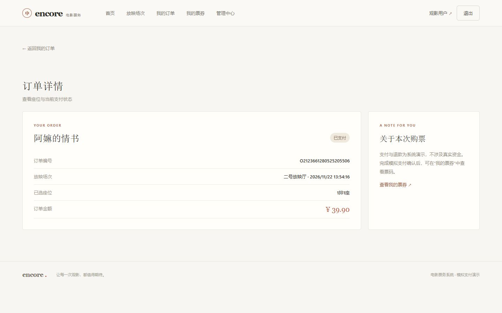

图 4-7 已支付订单

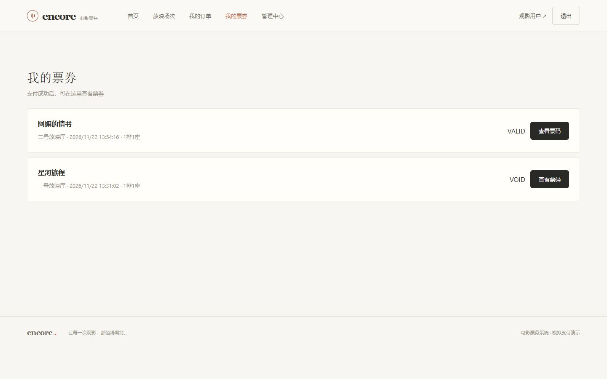

图 4-8 有效票券

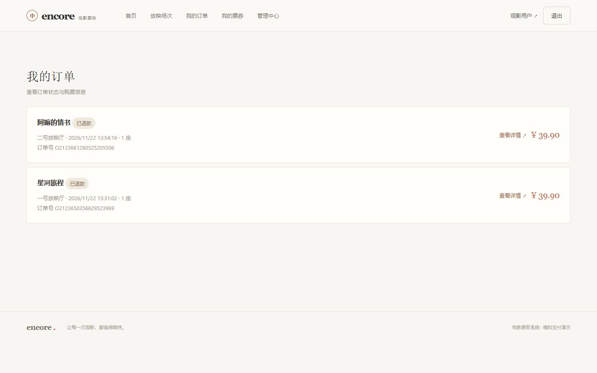

图 4-9 退款完成后的订单

### 4.5 配置、Bean 和异常处理
Spring IoC 容器负责管理对象及其依赖[14]；本机代理使用 Node.js 的 HTTP 能力处理转发[15]。

系统配置分为应用配置文件和 Java 配置类。数据源、Redis、Flyway 以及 Mapper XML 路径在配置文件中声明，数据库密码等值通过环境变量提供。项目的本地模拟支付入口同时受 profile、开关和管理员权限约束，用于课程演示，不作为真实支付入口。

Spring 容器根据配置创建并管理 Bean，并通过构造方法向使用者提供依赖。例如，订单控制器通过构造方法接收 `OrderService`，调用方不需要自行创建其具体实现。数据绑定将请求内容转换为请求对象，校验和业务处理异常按相应异常处理出口转换为约定的响应；客户端再根据响应状态展示信息。

分页插件和乐观锁插件由配置类注册为 Spring Bean，实际代码片段如下：

```java
@Bean
MybatisPlusInterceptor mybatisPlusInterceptor() {
    MybatisPlusInterceptor interceptor = new MybatisPlusInterceptor();
    interceptor.addInnerInterceptor(new PaginationInnerInterceptor(DbType.MYSQL));
    interceptor.addInnerInterceptor(new OptimisticLockerInnerInterceptor());
    return interceptor;
}
```

容器创建并管理该拦截器，相关数据访问功能可使用其分页与乐观锁插件；具体业务是否生效仍取决于相应查询和实体配置。个人中心页面如图 4-10 所示。

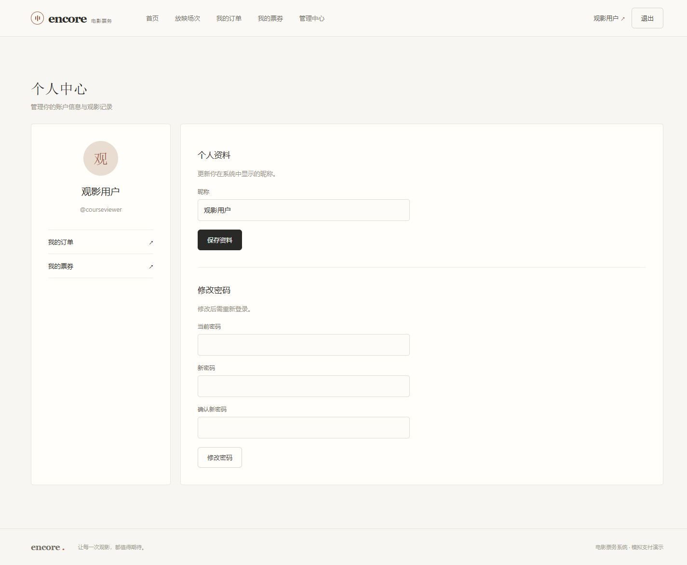

图 4-10 个人中心页面


#### 4.5.1 核心配置文件示例

本项目的 `application.yaml` 将数据源、Redis、Flyway 和 MyBatis-Plus 的关键配置集中管理。下列片段摘自实际配置，保留本次说明所需的字段；密码仍通过环境变量传入，报告不包含实际凭据。

```yaml
spring:
  datasource:
    url: jdbc:mysql://${MYSQL_HOST:127.0.0.1}:${MYSQL_PORT:3308}/${MYSQL_DATABASE:encore_ticket}?connectionTimeZone=UTC&characterEncoding=UTF-8
    username: ${MYSQL_USER:encore_ticket}
    password: ${MYSQL_PASSWORD}
  flyway:
    enabled: ${FLYWAY_ENABLED:true}
    locations: classpath:db/migration
  data:
    redis:
      host: ${REDIS_HOST:127.0.0.1}
      port: ${REDIS_PORT:6380}
      password: ${REDIS_PASSWORD}
mybatis-plus:
  mapper-locations: classpath:/mapper/*.xml
server:
  port: 8080
```

其中，`${变量:默认值}` 表示优先读取指定环境变量，未设置时使用冒号后的默认值；没有默认值的密码变量必须在启动环境中提供。`connectionTimeZone=UTC` 对应项目技术时间的连接配置；影院场次等业务时间的解释还需遵循项目的时区规则。Flyway 默认从 `db/migration` 查找版本脚本，MyBatis-Plus 从 `mapper` 目录加载自定义 XML。`server.port` 指定后端 HTTP 端口，本机 Node 代理则另行监听 8081。

在本次演示中，启动参数选择 `local` profile，并显式设置模拟支付开关；`AdminPaymentSimulationController` 同时检查允许的 profile、开关和管理员角色。普通运行配置中的 MySQL、Redis 地址及端口可以通过环境变量调整。配置片段用于说明本项目的运行方式，不能直接替代完整的运行环境说明。

#### 4.5.2 权限控制与定时任务

系统将公开查询与受保护操作区分处理。`SecurityConfig` 为影片、场次等指定只读入口以及登录、注册入口设置匿名访问规则，其他入口默认需要认证；`/admin/**` 要求管理员角色，票券核销入口要求检票人员角色。登录令牌由认证过滤器解析，订单和票券服务还要检查请求人与资源所属用户是否一致。页面是否显示按钮只影响交互，不构成服务端授权的替代方案。

订单存在付款期限，未付款订单达到条件后需要释放仍由该订单占用的场次座位。项目启用 Spring 定时任务，`OrderExpirationScheduler` 按配置的固定间隔调用到期订单服务，配置项可控制该扫描任务是否启用。定时扫描用于推进状态，但用户发起业务操作时仍需依据当前时间和状态进行判断；不能因为任务尚未执行，就认为过期订单仍然具备付款或取消资格。该设计展示了任务调度与业务规则相结合的处理方式，并不代表所有并发交错均已通过测试。

#### 4.5.3 个人资料与密码管理

个人中心通过 `GET /users/me` 获取当前登录用户资料。用户提交昵称后，页面调用 `PATCH /users/me`，控制器使用认证上下文中的用户标识调用服务层，服务端校验并更新允许修改的资料字段。页面收到成功响应后重新读取个人资料，使顶部账号名称和页面中的昵称保持一致。该过程不允许客户端通过请求指定其他用户标识完成资料修改。

密码修改使用独立的 `PUT /users/me/password` 入口，请求包含旧密码、新密码和确认密码。后端先校验输入，再检查旧密码和账号版本；修改成功后旧登录态应失效，用户需要重新登录。密码内容不在报告和运行日志中展示。该功能在本次测试中通过接口验证了新密码登录和旧令牌失效，验证结束后恢复了演示账号密码。

### 4.6 一次下单请求的分层协作

以下以本次演示中的创建订单为例，说明浏览器、控制层、服务层和数据访问层的协作过程。该过程涉及的数据及返回结果来自实际接口设计，具体订单编号随每次运行而变化。

（1）页面提交请求。用户在选座页面选择一个或多个场次座位后，前端从当前选择集合中取得场次座位标识，向 `POST /orders` 发送 JSON，并在 `Idempotency-Key` 请求头中放入本次业务操作的唯一键。请求体只包含 `screeningId` 与 `screeningSeatIds`；订单金额、用户标识和订单状态不由页面决定。标识以字符串传递，避免浏览器处理大整数时出现精度损失。请求结构示例如下，其中数值仅为格式示意，不代表现有演示数据库的真实标识。

```json
{
  "screeningId": "10001",
  "screeningSeatIds": ["30001", "30002"]
}
```

（2）控制层接收数据。Spring MVC 将 JSON 请求体绑定为 `CreateOrderRequest` 对象。该对象声明场次标识和座位标识列表，并使用严格字符串反序列化处理；未知字段由请求对象拒绝。`UserOrderWorkflowController.create` 读取请求头、请求体和认证信息，检查请求键头数量，再将服务端认证得到的用户标识、请求键和请求对象传给 `OrderService`。控制层并不从请求体取得订单所属用户。

（3）服务层执行规则。`OrderServiceImpl.create` 检查用户标识、请求键格式、座位数量及重复座位，将场次和座位标识转换后按座位标识排序，并生成请求摘要。服务层通过 `TransactionTemplate` 组织数据库事务：检查已有幂等快照，锁定相关业务数据，检查是否存在有效待支付订单，以及场次和座位是否仍可购买；符合条件时插入订单和明细、占用座位并保存响应快照。已到期旧订单的释放采用先提交、再重新检查新购条件的处理方式，避免新订单失败时撤销旧订单的过期释放。

（4）数据访问层读写数据。订单流程中的 `OrderWorkflowMapper` 使用 Spring `JdbcTemplate` 执行 SQL，而非通过 MyBatis-Plus `BaseMapper` 完成全部操作。例如，检查购买资格时读取场次、影片、影厅及场次座位状态；插入订单时读取服务端场次价格，并根据座位数量计算总额；随后插入订单明细，并以包含 `status=0` 条件的更新语句占用座位。如果必要数据不存在或条件更新不符合预期，业务处理将返回异常或冲突结果。

（5）结果返回页面。数据访问层查询订单详情后组装 `OrderDetailVO`，服务层将结果返回控制器；控制器使用 `ApiResponse` 包装并返回 HTTP 201。前端取得订单标识后进入订单详情页，展示订单状态、场次、座位与金额。若用户未登录、请求参数不合法或座位状态冲突，页面依据服务端响应提示用户处理，不能把失败响应当成创建成功。

### 4.7 数据访问、配置与异常处理实例

影片模块与订单跨表流程采用不同的数据访问方式。`MovieMapper` 继承 MyBatis-Plus 的 `BaseMapper<Movie>`，同时声明影片分页查询等方法，自定义 SQL 放在资源目录的 Mapper XML 中；`application.yaml` 通过 `mybatis-plus.mapper-locations` 指定 XML 路径。`MybatisPlusConfig` 注册 `MybatisPlusInterceptor`，并加入 MySQL 分页与乐观锁内部插件。是否使用插件仍取决于具体查询和实体配置，不能仅凭注册插件认定所有查询均已分页或所有更新均具备乐观锁。

应用入口类标注 `@SpringBootApplication` 并调用 `SpringApplication.run`，启动时由 Spring 创建应用上下文。以订单控制器为例，`UserOrderWorkflowController` 的构造方法声明 `OrderService`，Spring 根据容器中的实现提供依赖；控制器调用接口而不直接构造 `OrderServiceImpl`。分页拦截器由 `MybatisPlusConfig` 的 `@Bean` 方法创建，说明项目既使用组件扫描，也使用配置类注册 Bean。

配置文件中的 `spring.datasource` 配置数据库连接，`spring.data.redis` 配置登录态存储所用 Redis，`spring.flyway` 指定迁移脚本位置及校验行为，`server.port` 设置后端端口。连接密码由环境变量提供。本次演示启用 `local` profile，并显式启用模拟支付开关；支付模拟控制器还要求管理员角色。profile 用于区分配置及组件生效环境，不能单凭启用本地环境推定全部演示接口均已启用。

登录接口 `UserAuthController.login` 将请求体绑定为 `LoginRequest`，并使用 `@Valid` 触发用户名和密码非空校验。对于 MVC 可见的业务异常和参数校验异常，`GlobalExceptionHandler` 使用 `@RestControllerAdvice` 及 `@ExceptionHandler` 处理，统一返回错误码、提示信息和请求标识。认证与权限失败还涉及 Spring Security 的处理入口，容器错误也有独立出口，因此统一错误处理并非只由一个类完成。

例如，未提供必填参数或请求内容格式不正确时，客户端可能收到 HTTP 400 和 `INVALID_ARGUMENT`；无有效登录身份时受保护入口返回 HTTP 401；数据状态冲突时可返回 HTTP 409。具体状态及错误码以相应接口和异常映射为准。该机制使页面可以提示用户当前问题，也便于通过 `requestId` 关联服务端诊断信息。

## 5 系统测试
2026 年 11 月 20 日，在本机独立 MySQL 数据库和 Redis 中完成 13 项 Flyway 迁移，后端启动并查询影片成功。使用实际 HTTP 接口验证注册、查询场次与座位、创建订单、发起支付、管理员发送模拟成功事件，最终查询到 1 张票券；继续申请退款后，查询到退款 SUCCESS、订单 REFUNDED。页面已检查首页、场次、座位、管理员登录和管理中心；另已通过浏览器完成一次下单、模拟支付、出票及退款流程，见 5.1。

运行 Maven 默认测试，统计 761 项，其中 597 项通过、0 项失败、0 项错误、164 项跳过。跳过的真实依赖等测试不能认定通过。上述验证只证明已执行的测试范围，不代表所有并发和异常情况均已验证。


本次主要功能测试结果如表 5-1 所示。

表 5-1 本次主要功能测试结果

| 编号 | 测试条件与步骤 | 预期结果 | 实际观察 |
|---|---|---|---|
| 1 | 游客访问首页，查询演示影片、场次和座位 | 显示公开信息及座位状态 | 浏览器显示影片、场次与座位 |
| 2 | 普通用户选择 1 排 1 座并提交订单 | 创建待支付订单，显示场次、座位和金额 | 订单显示待支付，金额 39.90 元 |
| 3 | 普通用户发起模拟支付；管理员在本地管理页确认成功 | 订单支付成功并生成票券 | 订单显示已支付，票券显示 VALID |
| 4 | 普通用户对该已支付订单申请整单退票，等待处理后刷新 | 订单变为已退款，原票券作废 | 订单显示已退款，票券显示 VOID |
| 5 | 已登录用户在页面修改昵称并重新读取 | 保存成功，页面显示新昵称 | 网页提示更新成功，顶部与个人中心昵称同步；之后恢复原值 |
| 6 | 通过接口修改密码，使用旧令牌访问并以新密码登录 | 旧令牌失效，新密码可登录 | 旧令牌访问被拒绝，新密码登录成功；之后恢复演示密码 |

上述测试使用本机独立 MySQL、Redis 和演示账号，其中模拟支付由管理员角色在 `local` 环境中确认；密码修改通过 HTTP 接口验证。表中记录的是实际观察结果，不将测试条件以外的情况视为已验证。

### 5.1 网页购票与退票验证
在 2026 年 11 月 20 日，使用普通演示账号从浏览器为《阿嫲的情书》选择二号放映厅 1 排 1 座并提交订单，订单显示待支付，金额为 39.90 元。用户发起模拟支付后页面显示等待管理员确认；管理员在本机演示管理页面确认支付成功，普通用户刷新后看到订单已支付，票券列表出现有效票券。随后用户申请整单退票，页面先显示退款处理中，刷新后显示已退款，票券状态变为作废。该流程使用模拟渠道，不涉及真实资金；不代表并发及所有边界场景均已覆盖。

待支付订单与模拟支付等待确认页面分别如图 5-1 和图 5-2 所示。

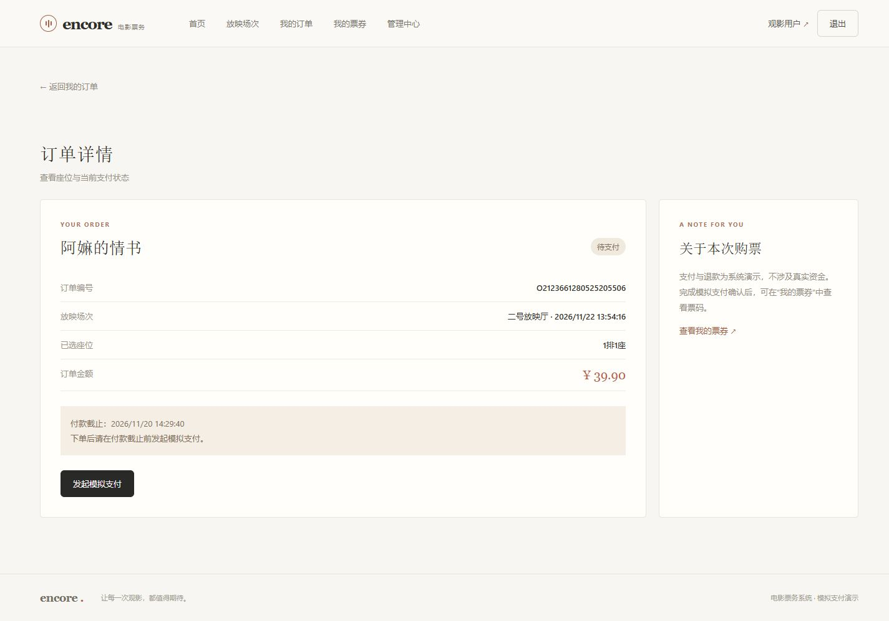

图 5-1 待支付订单

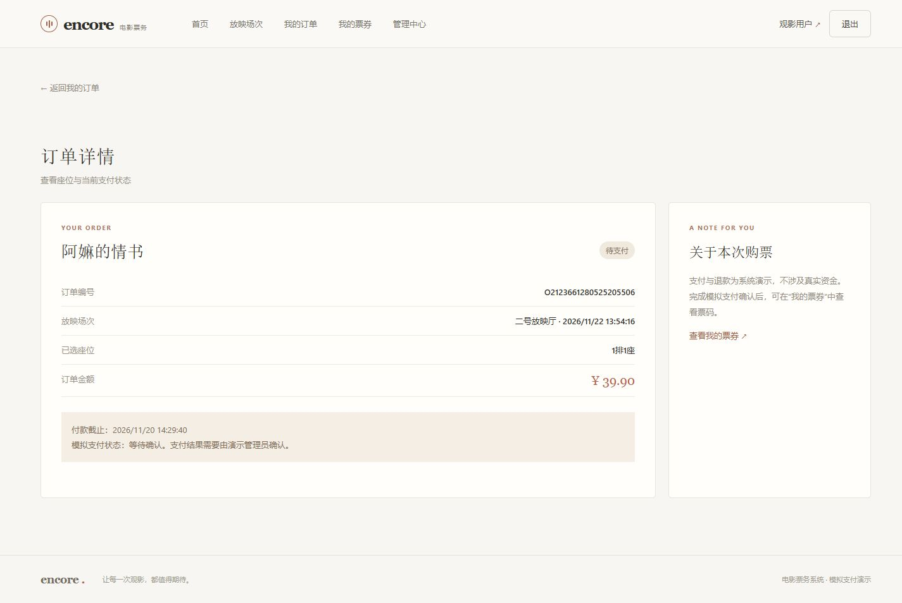

图 5-2 模拟支付等待确认

### 5.2 用户资料和密码验证
在本机演示环境中，使用已登录用户将昵称修改为“观影用户测试”，重新查询确认修改生效，随后恢复原昵称。浏览器复验表明保存后顶部及个人中心昵称同步更新。使用真实接口修改密码后，原令牌访问个人信息被拒绝，使用新密码重新登录成功；验证结束后恢复演示密码。该验证覆盖正常修改与旧令牌失效，不代表所有异常及并发场景均已验证。

### 5.3 测试结果分析

本次功能测试覆盖了公开查询、一次正常购票、模拟支付确认、出票和整单退款，测试结果与预期流程一致。用户资料测试验证了昵称修改后的回读以及页面同步显示；密码测试通过接口验证了新密码登录和旧令牌失效。上述结果说明系统的主要业务链条在本次隔离环境中可以运行，但不意味着所有失败恢复、并发竞争和边界时间均已得到充分验证。

默认 Maven 测试结果应结合跳过数量解释：761 项中有 164 项跳过，实际通过 597 项。未执行的测试不能作为通过证据；单次浏览器演示也不能替代针对真实数据库锁竞争的专项测试。因此，本报告仅对实际执行并观察到的结果作出结论，后续应根据部署环境补充必要的异常场景和集成测试。

## 6 结论
本设计实现了单影院电影票务系统的主要后端流程，并初步提供浏览器界面。项目通过 Spring Boot 分层组织业务，结合 MyBatis-Plus、事务和角色权限展示 Web 开发技术。在本机部署过程中，使用独立的 MySQL 与 Redis 实例完成演示，项目启动及配置过程需要按照运行环境说明进行。系统的不足包括支付渠道为模拟、尚未覆盖多影院和部分退款，前端与后台管理仍需进一步完善，并应补充更多异常场景验证。

## 参考文献
[1] 中共中央，国务院. 数字中国建设整体布局规划[EB/OL]. (2023-02-27)[2026-11-20]. https://www.gov.cn/zhengce/2023-02/27/content_5743484.htm.
[2] MDN Web Docs. 客户端服务端交互概述[EB/OL]. [2026-11-20]. https://developer.mozilla.org/zh-CN/docs/Learn_web_development/Extensions/Server-side/First_steps/Client-Server_overview.
[3] MDN Web Docs. HTTP 概述[EB/OL]. [2026-11-20]. https://developer.mozilla.org/zh-CN/docs/Web/HTTP/Overview.
[4] MDN Web Docs. JavaScript[EB/OL]. [2026-11-20]. https://developer.mozilla.org/zh-CN/docs/Web/JavaScript.
[5] MyBatis-Plus. 分页插件[EB/OL]. [2026-11-20]. https://baomidou.com/plugins/pagination/.
[6] Redgate. Redgate Flyway Documentation[EB/OL]. [2026-11-20]. https://documentation.red-gate.com/flyway/.
[7] SpringDoc. Spring Boot 中文文档[EB/OL]. [2026-11-20]. https://springdoc.cn/spring-boot/.
[8] MyBatis-Plus. 持久层接口[EB/OL]. [2026-11-20]. https://baomidou.com/guides/data-interface/.
[9] MyBatis-Plus. 注解配置[EB/OL]. [2026-11-20]. https://baomidou.com/reference/annotation/.
[10] 菜鸟教程. MySQL 事务[EB/OL]. [2026-11-20]. https://www.runoob.com/mysql/mysql-transaction.html.
[11] 菜鸟教程. Redis 教程[EB/OL]. [2026-11-20]. https://www.runoob.com/redis/redis-tutorial.html.
[12] Spring. Spring Security Reference[EB/OL]. [2026-11-20]. https://docs.spring.io/spring-security/reference/.
[13] Spring. Transaction Management: Spring Framework Reference[EB/OL]. [2026-11-20]. https://docs.spring.io/spring-framework/reference/data-access/transaction.html.
[14] Spring. The IoC Container: Spring Framework Reference[EB/OL]. [2026-11-20]. https://docs.spring.io/spring-framework/reference/core/beans.html.
[15] OpenJS Foundation. HTTP: Node.js Documentation[EB/OL]. [2026-11-20]. https://nodejs.org/docs/latest/api/http.html.


